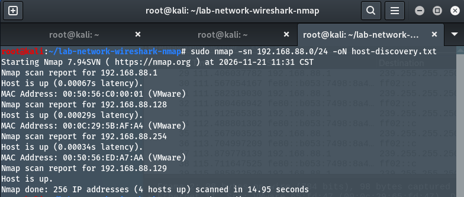
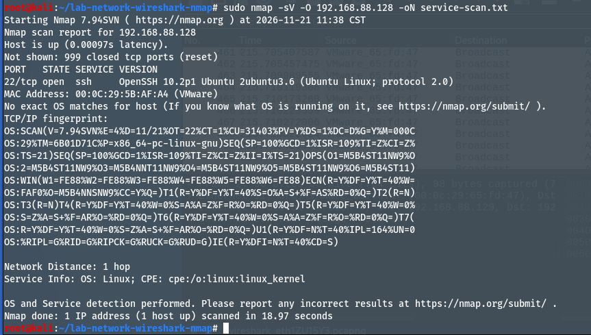
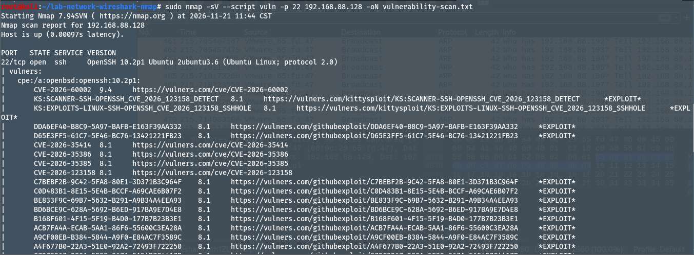
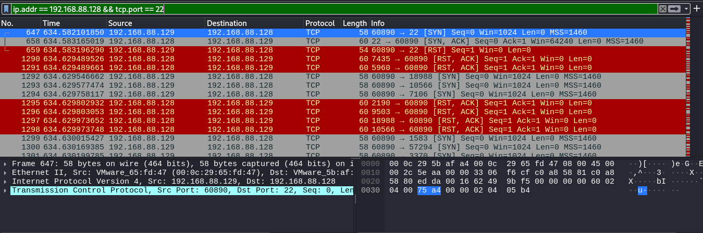
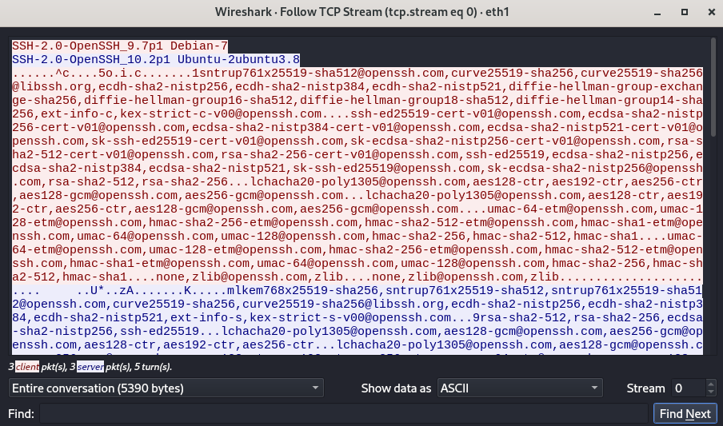
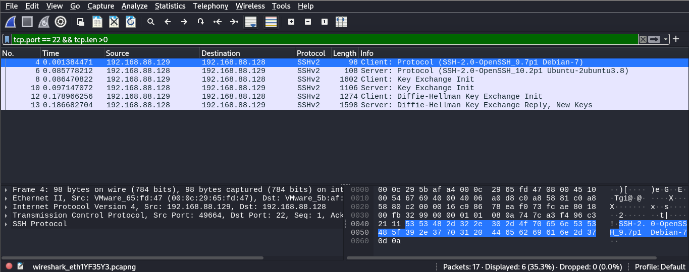

# Lab 1 - Network Traffic and Vulnerability Scan
## Wireshark & Nmap | Cybersecurity Home Lab

### Overview
In this lab, I used Nmap to discover active hosts, identify open ports and services, and investigate potential vulnerability indicators on an isolated VMware network. I then used Wireshark to capture and analyze TCP and SSH traffic generated during the investigation.

### Objectives
- Discover active hosts on a controlled lab network.
- Identify open ports, services, and software versions.
- Investigate potential vulnerabilities using Nmap scripts.
- Analyze network traffic using Wireshark.
- Document findings and provide security recommendations.

### Tools Used
- Kali Linux — scanning and packet analysis
- Ubuntu Server — target machine
- Nmap 7.94SVN
- Wireshark
- VMware Workstation Pro 17

### Lab Environment and Scope

| Component | IP Address | Role |
|---|---|---|
| Kali Linux | 192.168.88.129 | Scanner |
| Ubuntu Server | 192.168.88.128 | Target |
| Network | 192.168.88.0/24 | VMware host-only network |

All scanning was performed on my own isolated virtual lab environment.

### 1. Network Discovery

**Command executed:**

```bash
sudo nmap -sn 192.168.88.0/24 -oN host-discovery.txt
```

**Results:**

Nmap identified four active hosts:

- 192.168.88.1 — VMware virtual network adapter
- 192.168.88.128 — Ubuntu Server
- 192.168.88.129 — Kali Linux
- 192.168.88.254 — VMware virtual network component

**Evidence:**



[View complete host discovery results](scans/host-discovery.txt)

### 2. Port and Service Enumeration

**Command executed:**

```bash
sudo nmap -sV -O 192.168.88.128 -oN service-scan.txt
```

**Results:**

| Port | State | Service | Detected Version |
|---|---|---|---|
| 22/tcp | Open | SSH | OpenSSH 10.2p1 Ubuntu 3ubuntu3.6 |

Nmap reported that the remaining 999 scanned TCP ports were closed.

Operating system detection indicated Linux, although an exact OS version was not confirmed.

**Security assessment:**

SSH is commonly used for secure remote administration. Its presence is expected on a Linux server, but unnecessary exposure could increase the attack surface.



[View complete service scan results](scans/service-scan.txt)

### 3. Vulnerability Assessment

**Command executed:**

```bash
sudo nmap -sV --script vuln -p 22 192.168.88.128 -oN vulnerability-scan.txt
```

**Results:**

The vulnerability scan returned multiple CVE and exploit references associated with the detected OpenSSH software.

The output included high and critical severity ratings.

**Important limitation:**

These results represent potential vulnerability matches, not confirmed exploitable weaknesses. The scan did not establish whether the reported issues apply to the installed Ubuntu packages.

Additional verification against Ubuntu security advisories and installed package information would be required before assigning a confirmed vulnerability status.



[View complete vulnerability scan results](scans/vulnerability-scan.txt)

### 4. Wireshark Traffic Analysis

Wireshark was used to capture network traffic on Kali Linux's host-only interface (`eth1`).

**Scan traffic filter:**

```text
ip.addr == 192.168.88.128 && tcp.port == 22
```

The capture showed TCP SYN packets sent from Kali Linux to Ubuntu Server.

Ubuntu responded with SYN-ACK packets on port 22, confirming that the SSH service was accepting TCP connection attempts.

RST packets were also observed during the scan.



### 5. TCP Stream Analysis

I used Wireshark's **Follow TCP Stream** feature to inspect SSH communication between Kali Linux and Ubuntu Server.

The captured protocol identification messages showed:

- SSH client: OpenSSH 9.7p1 Debian-7
- SSH server: OpenSSH 10.2p1 Ubuntu3.8
- Protocol: SSH-2.0

The stream also contained SSH algorithm negotiation and key exchange information.

The server's protocol banner differed in package revision from the earlier Nmap service detection. This difference was documented without assuming the cause.



### 6. SSH Traffic Filtering

**Display filter:**

```text
tcp.port == 22 && tcp.len > 0
```

This filter isolated SSH packets containing TCP payload data.

The captured packets showed:

- SSH protocol identification
- Client and server key exchange initialization
- Diffie-Hellman key exchange messages

These observations demonstrated the beginning of an SSH session and its cryptographic negotiation.



### 7. Findings and Recommendations

| Finding | Assessment | Recommendation |
|---|---|---|
| SSH port 22 open | Expected administrative service | Restrict access to trusted hosts |
| OpenSSH vulnerability references | Potential findings, not verified | Review applicable Ubuntu security advisories and package updates |
| SSH protocol negotiation | Expected behavior | Maintain secure SSH configuration and supported algorithms |
| Other scanned TCP ports closed | Reduced exposed TCP attack surface | Continue limiting unnecessary services |

### 8. What I Learned

This lab helped me understand how network discovery, service enumeration, vulnerability scanning, and packet analysis work together during a security assessment.

I learned that an open port does not automatically indicate a vulnerability and that automated vulnerability results require validation.

Wireshark helped me connect Nmap's scan results with actual TCP behavior, including SYN, SYN-ACK, and RST packets.

I also observed how SSH clients and servers exchange protocol information and negotiate cryptographic parameters.

One important limitation is that network scanning alone cannot confirm whether a service is fully secure or whether every reported CVE applies to the installed software.

### Disclaimer

All scanning and traffic analysis were performed on virtual machines within my own isolated VMware lab network for educational purposes. No unauthorized systems were scanned.
